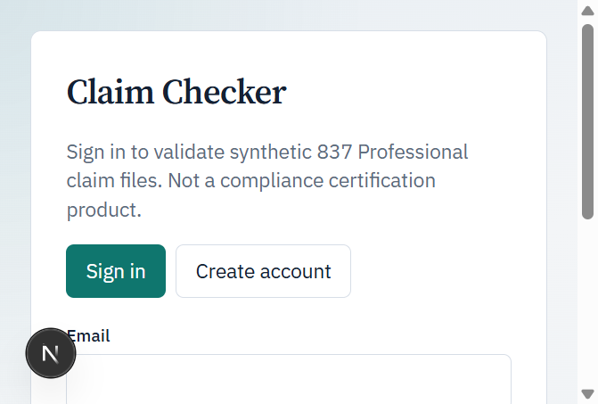
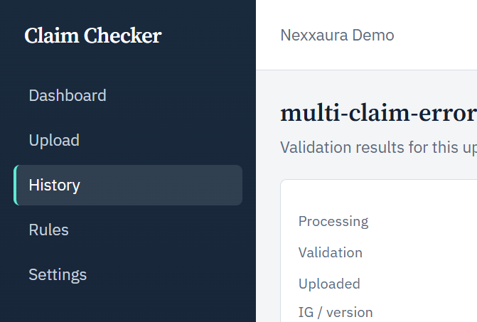
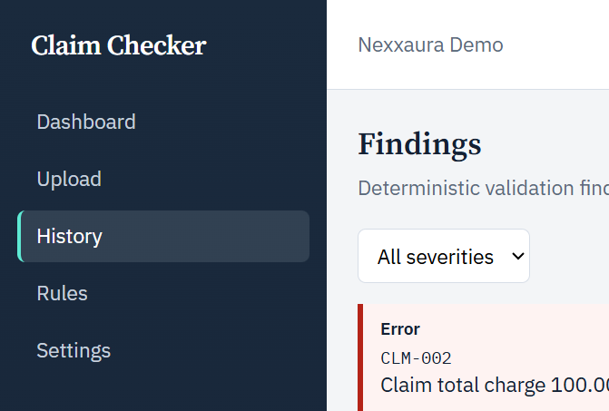
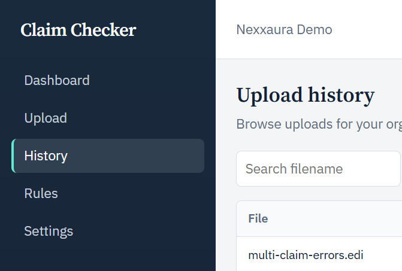

# Claim Checker

MVP for medical billing companies to validate **synthetic** X12 **837 Professional** (`005010X222A1`) uploads and produce deterministic validation reports.

> **Not** HIPAA certified. **Not** an X12 implementation-guide conformance product. Synthetic fixtures only.

**Portfolio narrative:** [`docs/case-study.md`](docs/case-study.md) · **10‑minute demo:** [`docs/demo.md`](docs/demo.md)

Synthetic demo only — not a compliance certification product.

### Screenshots

| Login | Upload detail (Processing vs Validation) |
|-------|------------------------------------------|
|  |  |

| Findings | History |
|----------|---------|
|  |  |

## Milestone status

| Milestone | Status |
|-----------|--------|
| 1 — Architecture & scaffold | Done |
| 2 — Parser | Done — `@claim-checker/edi-parser` |
| 3 — Normalized model + DB | Done — Prisma + persistence |
| 4 — Validation engine | Done — `@claim-checker/validation-rules` |
| 5 — API | Done — Express `/api/v1` |
| 6 — Frontend | Done — Next.js `apps/web` |
| 7 — E2E / security hardening | Done — [`docs/milestone-7.md`](docs/milestone-7.md) |
| **8 — Docker / CI / readiness** | **Done** — Compose, Dockerfiles, GitHub Actions, test DB isolation |

## Why this project

- End-to-end path: upload → parse → deterministic rules → findings → CSV  
- Org-scoped auth and audit boundaries (no raw EDI in logs)  
- UI separates **parse success** from **validation outcome**  
- Explicit non-goals (see [`docs/limitations.md`](docs/limitations.md))

## Repository layout

```text
apps/api          Express + Prisma
apps/web          Next.js UI
packages/edi-parser
packages/validation-rules
fixtures/edi      Synthetic EDI
docs/             Architecture, demo, case study
```

## Prerequisites

- Node.js ≥ 20, pnpm 9 (`corepack enable`)
- Docker (Postgres / optional full stack)

## Quick start (local)

```bash
pnpm install
cp .env.example .env
cp apps/api/.env.example apps/api/.env   # if needed
docker compose up -d postgres
# Existing volume? create test DB once:
# docker compose exec postgres psql -U claimchecker -c "CREATE DATABASE claimchecker_test;"
pnpm --filter @claim-checker/api db:generate
pnpm --filter @claim-checker/api exec prisma migrate deploy
pnpm --filter @claim-checker/api db:ensure-demo
pnpm --filter @claim-checker/api dev    # :3001
pnpm --filter @claim-checker/web dev    # :3000
```

Demo login: `demo@nexxaura.com` / `demo12345`

## Tests (isolated DB)

```bash
pnpm --filter @claim-checker/api db:migrate:test   # claimchecker_test
pnpm test
```

`TEST_DATABASE_URL` points at `claimchecker_test` so tests do **not** delete demo users.

## Docker (full stack)

```bash
docker compose up --build
# Web http://localhost:3000  API http://localhost:3001
```

## CI

GitHub Actions (`.github/workflows/ci.yml`): install → migrate test DB → typecheck → test → build.

## Documentation

| Doc | Purpose |
|-----|---------|
| [Case study](docs/case-study.md) | Portfolio / interview narrative |
| [Demo](docs/demo.md) | Step-by-step synthetic walkthrough |
| [Architecture](docs/architecture.md) | System design |
| [Database](docs/database.md) | Postgres, migrate, test DB |
| [Validation rules](docs/validation-rules.md) | Rule set `2026.10.4` |
| [Limitations](docs/limitations.md) | Honest non-goals |

## Environment

See [`.env.example`](.env.example). Never commit secrets or PHI.
